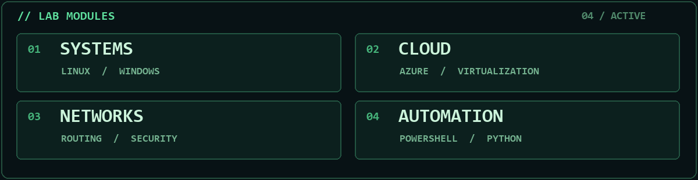

<!-- EREN KARAOĞLU · SYSTEMS / CLOUD / INFRASTRUCTURE -->

> **Curious about the systems behind the software.** 
> Infrastructure · Networking · Cloud · Automation

## 01 / whoami

Hey, I'm **Eren** — an Information Systems Engineering graduate exploring the infrastructure that keeps technology running. I enjoy getting hands-on with systems, tracing problems to their root cause, and turning what I learn into something useful.

## 02 / inside the lab

- **Systems & identity** — Linux, Windows Server, Active Directory
- **Cloud & virtualization** — Microsoft Azure, virtual machines, hybrid identity
- **Networking & operations** — network fundamentals, security, monitoring, resilience
- **Automation** — PowerShell, Bash, Python
- **Exploring** — Terraform, Ansible, Kubernetes

## 03 / selected projects

- **[InfraLab](https://github.com/erentechlabs/infralab-homelab)** — A segmented Proxmox homelab for networking, monitoring and operations automation.
- **[TheEye](https://github.com/erentechlabs/The-Eye)** — A Windows assistant that analyzes a selected window using local vision AI or an optional OpenAI provider.
- **[Notes Frontend](https://github.com/erentechlabs/notes_frontend)** — A responsive note-taking app with rich text editing and temporary sharing.

## 04 / learning loop

**Learn → Build → Troubleshoot → Automate → Repeat**

Currently deepening my understanding of **Windows Server, Linux and Active Directory**, with **Azure administration and hybrid identity** on the learning path.

 

<code>// understand the system · secure the infrastructure · automate the routine</code>
