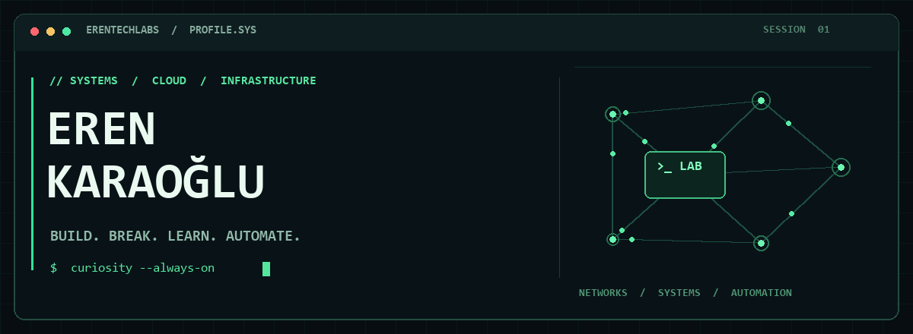
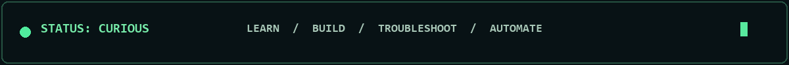

<!-- EREN KARAOĞLU · SYSTEMS / CLOUD / INFRASTRUCTURE -->

<div align="center">
  
  <br/><br/>
  <b>Curious about the systems behind the software.</b><br/>
  <sub>Infrastructure · Networking · Cloud · Automation</sub>
</div>

<br/>

### `01 / whoami`

Hey, I'm **Eren** — an Information Systems Engineering graduate exploring the infrastructure that keeps technology running. I like getting hands-on with systems, following problems down to their root cause, and turning what I learn into something useful.

```console
eren@lab:~$ cat focus.txt
systems administration  /  cloud infrastructure  /  networking
automation              /  troubleshooting        /  IT operations
```

### `02 / inside the lab`

| Domain | What I'm working with |
| :--- | :--- |
| **Systems & identity** | Windows Server, Linux, Active Directory |
| **Cloud & virtualization** | Microsoft Azure, virtual machines, hybrid identity |
| **Networking & operations** | Network fundamentals, security, monitoring, resilience |
| **Automation** | PowerShell, Bash, Python |
| **Exploring** | Terraform, Ansible, Kubernetes |

### `03 / selected projects`

**[InfraLab ↗](https://github.com/erentechlabs/infralab-homelab)**<br/>
A segmented Proxmox homelab exploring VLANs, Linux routing, firewalling, monitoring and operations automation.

**[TheEye ↗](https://github.com/erentechlabs/The-Eye)**<br/>
A Windows assistant that analyzes a selected window with local vision AI or an optional OpenAI provider.

**[Notes Frontend ↗](https://github.com/erentechlabs/notes_frontend)**<br/>
A responsive note-taking app with rich text editing and temporary sharing, built with React and TypeScript.

### `04 / learning loop`

```text
  UNDERSTAND  ──►  EXPERIMENT  ──►  TROUBLESHOOT  ──►  AUTOMATE
       ▲                                                    │
       └─────────────────── REPEAT ◄────────────────────────┘
```

Currently deepening my understanding of **Windows Server, Linux and Active Directory**, with **Azure administration and hybrid identity** on the learning path.

<div align="center">
  <br/>
  <a href="https://github.com/erentechlabs?tab=repositories"><b>Explore all repositories ↗</b></a>
  <br/><br/>
  
  <br/>
  <sub><code>// understand the system · secure the infrastructure · automate the routine</code></sub>
</div>
